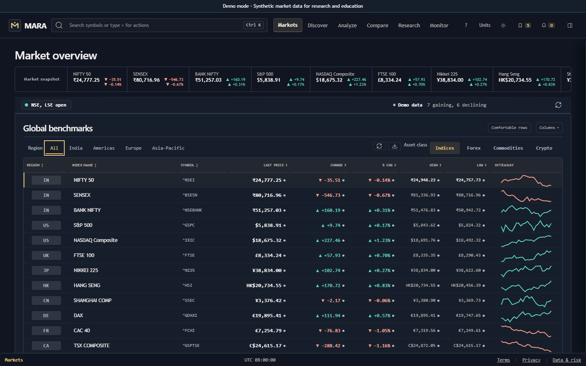
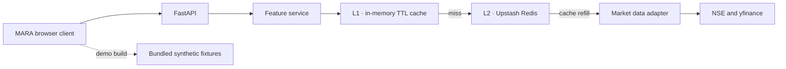

# MARA · Equities research terminal

Research Indian and global equities, compare market benchmarks, and inspect price action in a custom Canvas chart.

[Open the live demo](https://mara-stock-terminal.vercel.app/) · [Engineering benchmarks](BENCHMARKS.md)



[Interface design and Markets before-and-after](docs/design.md) · [Workspace screenshots](frontend/tests/visual.spec.js-snapshots/) · [Demo GIF](docs/assets/mara-demo.gif)

[](https://github.com/SriJayavel/Stock-Dashboard/actions/workflows/ci.yml)

## Run the demo

The demo loads bundled market fixtures and works without accounts, API keys, or a backend. Start with Markets, press **Ctrl+K** or **⌘K** to find TCS or AAPL, then press **?** for the keyboard shortcuts. Append `?freeze=1` before the hash route to freeze simulated prices.

```bash
git clone https://github.com/SriJayavel/Stock-Dashboard.git
cd Stock-Dashboard/frontend
npm ci
npm run build
npm run preview
```

Open the local URL printed by Vite.

## Architecture



The architecture decision records explain the [domain and adapter boundaries](docs/adr/0001-hexagonal-architecture.md), [cache lookup and refresh](docs/adr/0002-two-tier-hybrid-cache.md), [research methodology](docs/adr/0003-epistemological-contract-no-speculation.md), and [browser storage](docs/adr/0004-client-side-only-user-storage.md).

| Layer | Technology | Why |
| --- | --- | --- |
| Client | Vanilla JavaScript and Vite | Static, no-backend demo and direct DOM updates |
| Charting | Canvas 2D, JavaScript indicators and backtester | Custom price rendering and auditable calculations |
| API | FastAPI and Python | Typed service boundaries and provider adapters |
| Cache | TTLCache and Upstash Redis | Fast local reads with a shared second tier |
| Verification | pytest, Node test runner, Playwright | Contracts, deterministic series, and browser workflows |

## Measured results

- **L1 workload throughput** was 8,245.8 requests/sec in a sequential in-process simulation. **L1 lookup latency** was 0.0094 ms at p95. The first measurement includes workload generation and bookkeeping.
- **Simulated cache hit rate** was 94.85% across 2,000 requests with popularity weights `[0.25, 0.20, 0.15, 0.10, 0.10, 0.05, 0.05, 0.05, 0.025, 0.025]` and the most popular symbols prewarmed.
- **Indicator formula checks** recorded max absolute error below 1e-12 (measured maximum 5.6843e-13). The independent pandas check used the bundled AAPL and TCS histories.
- **Provider fallback** passed a simulation with injected HTTP 403 and timeout errors at the primary quote adapter.

Run `npm run benchmark` from the repository root after installing `backend/requirements.txt`. [BENCHMARKS.md](BENCHMARKS.md) records the machine, commands, and raw results.

## Run the full stack

From the repository root:

```bash
python -m pip install -r backend/requirements.txt
python -m uvicorn backend.main:app --port 8080
```

In a second terminal:

```bash
cd frontend
npm ci
npm run dev
```

Vite proxies API and WebSocket requests to the local backend. The Dockerfile packages the provider-backed build. A separately hosted frontend can use `npm run build:live` with `VITE_API_BASE_URL` set to the FastAPI origin. The scheduled cache warmer calls the protected refresh endpoint to populate market snapshots.

## Development

| Path | Purpose |
| --- | --- |
| [`backend/`](backend/) | FastAPI routes, domain contracts, provider adapters, and Python tests |
| [`frontend/`](frontend/) | Vite app, Canvas chart, browser tests, and bundled demo fixtures |
| [`scripts/`](scripts/) | Fixture generators and frontend secret scanning |
| [`benchmarks/`](benchmarks/) | Reproducible cache, indicator, and failover checks |
| [`docs/`](docs/) | Architecture decisions, screenshots, and compliance notes |

From the repo root, run the backend suite. Pytest reads its settings from [`pyproject.toml`](pyproject.toml).

```bash
python -m pip install -r backend/requirements.txt pytest pytest-asyncio
python -m pytest
```

Run the frontend checks against the built demo. The local Playwright run uses Google Chrome.

```bash
cd frontend
npm ci
npm run lint
npm run typecheck
npm run test:unit
npm run build:demo
npm run test:demo
```

From the repo root, use `npm run gen:demo` to regenerate the seeded market snapshot and benchmark histories. Use `node scripts/gen-stock-candles.cjs --candles-only` to regenerate the stock candles and their matching quote fixtures.

## What I would do next

- Extend the typed contract between API responses and workstation views.
- Virtualize the screener table for larger universes.
- Add provider-specific timing and cache hit metrics to the refresh worker.

## Data and compliance

The public demo uses synthetic market data for research and education and cannot place trades.

See the [data and compliance note](docs/compliance.md) for provider terms and research output considerations.

## License

MIT. Third-party data and assets keep their own terms.
