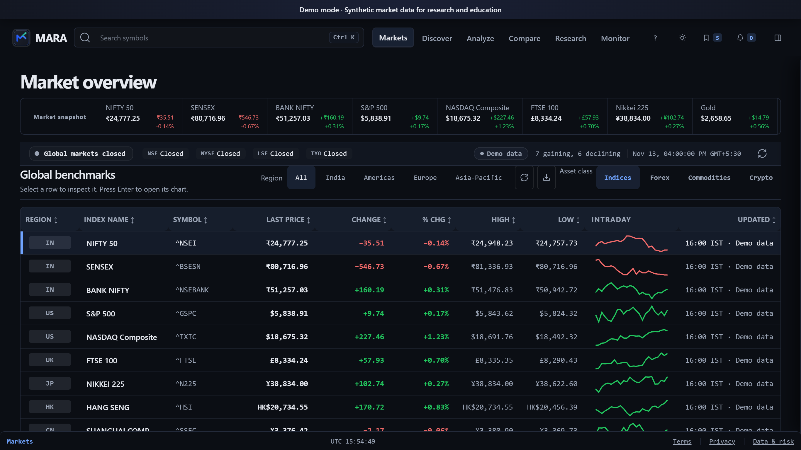
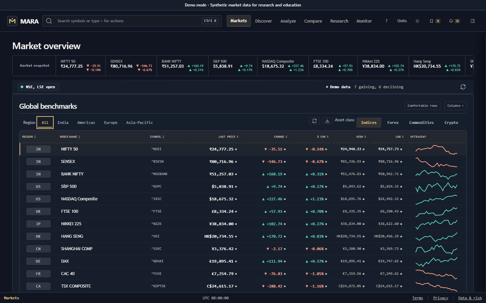

# MARA interface design

MARA puts the origin of a figure next to the figure itself. A solid dot marks source data, ƒ marks a calculation, a quote treatment marks attributed context, and an Interpretation label identifies observations alongside their factual basis. Valuation shows a position within the available range. The live five-year range uses a constant-earnings proxy derived from historical closes.

The benchmark strip and table render from one symbol-keyed snapshot. The synthetic demo updates those same quote records, including price, point change and percentage change. The demo labels its figures as sample data and omits fixture timestamps on Markets.

The interface uses navy surfaces, amber controls, and tabular figures in a monospace family. Teal and coral encode price direction alongside a triangle and sign. The market table offers two row densities, a column picker and sortable headers. On phones, the index rows stack and the six workspaces sit in the bottom navigation.

The IST timeline uses regular equity session hours, exchange-local weekdays and the 2026 holiday calendars. Its clock converts NYSE and London sessions through their exchange time zones so seasonal offsets are reflected in the display.

[NSE calendar](https://nsearchives.nseindia.com/content/circulars/CMTR71775.pdf) · [NYSE calendar](https://www.nyse.com/trade/hours-calendars) · [LSE calendar](https://www.londonstockexchange.com/en/resources/markets-products/business-days) · [JPX calendar](https://www.jpx.co.jp/english/corporate/about-jpx/calendar/index.html)

## Markets before and after

| Before | After |
| --- | --- |
|  |  |

[Provenance close-up](../frontend/tests/visual.spec.js-snapshots/provenance-detail-win32.png)

## Verification

The demo Playwright suite passed 21 tests. Its 12 axe scans found zero serious or critical issues across the six workspace views in both themes under the WCAG 2.0 and 2.1 A and AA tags. The suite also checks quote agreement before and after simulated updates, keyboard and touch disclosures, the index-pair action, and persisted table preferences.

All 12 visual regression scenarios passed. The [visual baselines](../frontend/tests/visual.spec.js-snapshots/) capture six workspaces in both themes at 1440 × 900, plus an open provenance card, using Chrome on Windows. To compare on Windows, build the demo and run the visual suite.

```powershell
npm --prefix frontend run build:demo
$env:MARA_VISUAL = '1'
npm --prefix frontend run test:demo
Remove-Item Env:MARA_VISUAL
```

Lighthouse 13.0.1 mobile runs used the Markets route with simulated ticks paused.

| Build | Performance | Accessibility | Best Practices | SEO | Total Blocking Time |
| --- | ---: | ---: | ---: | ---: | ---: |
| Existing public deployment | 56 | 100 | 100 | 100 | 11.38 s |
| Local redesign preview | 60 | 100 | 100 | 100 | 2.25 s |

The local run recorded 3.4 s Largest Contentful Paint and zero Cumulative Layout Shift. Performance remains below the target of 90. The local trace shows style and layout work among the measurable costs and leaves its longest task unattributed. [Public demo](https://mara-stock-terminal.vercel.app/?freeze=1#/markets)
